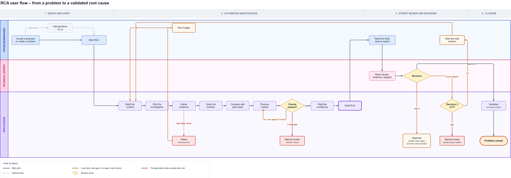

# 3. Proposed Solution and TO-BE Flow

**Project:** AI-assisted Root Cause Analysis (RCA) application
**Area:** Problem Management, large company
**Last updated:** 2026-10-22

---

## 3.1 The idea in short

The application first proposes which incidents look alike, so the Problem Manager can group
them into a **problem**. Every RCA starts from a problem.

The Problem Manager opens the problem and presses one button, **Start RCA**. The application
then does automatically what an expert used to do by hand: it reads every incident of the
problem, checks the service dependencies, collects the changes and the logs around the
incidents, searches the past incidents and past RCAs, and puts everything on one timeline.

Out of this it writes a **draft RCA**: one or more candidate root causes, each with the
evidence that supports it and a link to where that evidence came from.

The Problem Manager reads the draft and sends it to a Technical Expert, who approves it,
rejects it, or asks for more details. Only a human approval makes a root cause validated.

The change compared to today is simple: **the expert starts from a prepared case instead
of an empty page.**

---

## 3.2 The TO-BE flow, step by step

| Step | What happens | Who |
|---|---|---|
| 1 | Proposes groups of alike incidents as problems | Application |
| 2 | Accepts a proposal, or creates a problem from chosen incidents | Problem Manager |
| 3 | Opens the problem, adds optional guidance, and starts the RCA | Problem Manager |
| 4 | Builds the context of the problem: its incidents, services and time windows | Application |
| 5 | Plans the investigation: the search queries, and extra searches if needed | Application |
| 6 | Collects the service dependencies, the changes and the logs, and the similar past incidents | Application |
| 7 | Stores every fact found as a separate piece of evidence, with its source, and orders it on a timeline | Application |
| 8 | Compares the problem with past RCAs and past incidents of the same service, and keeps only the ones that really match | Application |
| 9 | Writes the candidate root causes, the cause diagram, and what could not be checked | Application |
| 10 | Checks the answer and calculates the confidence of every candidate cause | Application |
| 11 | Reads the draft and sends it to the Technical Expert | Problem Manager |
| 12 | Reads the causes, the evidence and the diagram, then approves, rejects, or asks for more details | Technical Expert |
| 13 | If more details are asked: starts the next revision, which answers the request | Problem Manager |
| 14 | If approved: the root cause is validated and the problem is closed | Application |

Steps 4 to 10 are the part that used to take days. They now run in one go, in the
background, without a person in between. The Problem Manager can leave the page; the run
continues and every finished step is shown as soon as it ends.

Step 3 has optional guidance. By default the application decides the services and the
time windows by itself. Before starting, the Problem Manager can add notes, questions for
the investigation, more services to search, and wider windows for the changes (up to 90
days) and the logs (up to 168 hours). The guidance is saved on the problem and used again
by the next RCA. It is a hint for the investigation, never a fact.

---

## 3.3 User flow diagram

Three lanes, in the order they appear: what the Problem Manager does, what the Technical
Expert does, and what the application does on its own. Time runs from left to right,
through the four phases named at the top. The steps are named shortly here; what each role
actually sees is in 3.4, and the states are in 3.5.



*Figure 3.1 — The user flow, from a problem to the validated root cause.*

Both roles see the same RCA, because the result belongs to both of them. The application
does the investigation, the Technical Expert validates the technical part, and the Problem
Manager owns the problem and the process.

---

## 3.4 What each role sees

The application is a web app in English and Romanian. Each user signs in, and sees only
the pages of their role.

**Problem Manager**

- **Home:** how an investigation works, and shortcuts to the problems and the proposals.
- **Proposed problems:** groups of alike incidents, incidents for an open problem, and
  incidents on their own, each with a similarity score and the reasons. Accept or reject,
  or create a problem by hand from chosen incidents (a reason is required).
- **Problems:** the list by status, and the page of each problem: its incidents (add or
  remove, with a reason), the guidance, the Start RCA button, its RCAs, and its full
  history. A problem can be closed or reopened, with a reason.
- **Investigation:** the steps of the run while it runs, and the results: the inputs, the
  candidate causes, the summary and workaround, the evidence, what was not verified, the
  timeline, the checks, the cause diagram, the evidence map and the steps. A button sends
  the draft to the Technical Expert, or starts the next revision, or runs a failed run again.
- **RCA history:** every RCA with its revisions, its status history and the decisions.
- **KPIs:** the four KPIs for a chosen period (document 7).

**Technical Expert**

- **Home:** the RCAs waiting for review.
- **Technical review:** the list of RCAs the Problem Manager sent.
- **The review page:** the cause diagram, the candidate causes ordered by confidence, the
  evidence for and against each one, why the confidence is high or low, what could not be
  checked, and what changed since the previous revision.
- Three buttons: approve (choose the validated cause), request more details (say what to
  verify, optionally ask for wider searches), reject (with a reason).

The expert sees only the RCAs that were sent for review, and the incidents of those RCAs.

---

## 3.5 The states of an RCA

| State | Meaning | Who acts next |
|---|---|---|
| Draft | The latest revision is running, or its draft waits to be sent | Application, then the Problem Manager |
| Awaiting technical review | The Problem Manager sent the draft to the expert | Technical Expert |
| More details requested | The expert asked for something specific | Problem Manager, who starts the next revision |
| Validated | The expert approved a candidate cause as the root cause; the problem is closed | Nobody, the RCA is closed |
| Rejected | The expert refused the analysis; the problem is open again | Problem Manager, with a new RCA that starts from something new |
| Manual review | The application stopped; people solve it outside | A human investigation outside the application |
| Failed | The run stopped on a technical error; nothing was concluded | Problem Manager, who runs it again |

A problem has its own status: **Open**, **In investigation** (while its RCA is in progress),
**Manual review** and **Closed**. A problem has one RCA at a time.

An RCA can only become **Validated** through a human approval. There is no path where the
application validates an RCA by itself.

---

## 3.6 The human decision points

There are two, and they are different on purpose.

**The Problem Manager decides what is investigated, and when the expert sees it.** The
application only proposes groupings. The Problem Manager decides which incidents form a
problem, starts the RCA, and reads the draft before sending it. Nothing goes to the expert
automatically.

**The Technical Expert approves the content.** This is the mandatory control point. The
expert answers the question: *is this hypothesis technically correct, and does the evidence
really support it?*

The three possible answers:

- **Approve** — the expert chooses one candidate cause. It becomes the validated root
  cause, and the problem is closed by this RCA.
- **Reject** — the analysis is refused, with a reason, and the problem is open again. A new
  RCA must start from something new (other incidents or other guidance), because the same
  input would give the same answer. After the **second** rejected RCA, the problem goes to
  manual review.
- **Request more details** — the expert says exactly what to verify, and can ask for wider
  searches. The Problem Manager starts the next revision, which answers the request; the
  earlier revision is kept next to it. The expert decides at most **three** times on one
  RCA. Asking for more at the third decision sends the RCA to manual review instead, so the
  loop cannot continue forever.

---

## 3.7 How this solves the problems from document 2

| Bottleneck today | How the solution removes it |
|---|---|
| Information spread across many systems | One investigation queries all sources in one run |
| Old RCAs are found by keyword, or not at all | Search by meaning, so different wording still matches |
| Waiting for other teams | The data is collected directly, without asking a person |
| Manual correlation of the timeline | The timeline is built automatically from the collected evidence |
| Expert time used for searching | The expert receives a prepared case and only reviews it |
| The first plausible cause wins | At least two hypotheses are proposed, or a reason is given why only one |
| The result depends on the person | Every RCA has the same structure and the same steps |
| Evidence is not traceable | Every statement points to the record it came from |
| Recurrence is noticed too late | Alike incidents are proposed as one problem, and a closed problem that comes back is flagged |

---

## 3.8 What goes in and what comes out

**In.** A problem and its incidents. An incident carries symptoms and context only, never
the answer. Shortened here to the most recent incident of the problem.

```json
{
  "problem_id": "PRB-2026-00106",
  "title": "Payment API intermittent failures",
  "status": "Open",
  "priority": "P1",
  "services": ["Payment API"],
  "incidents": ["INC-2026-00482", "INC-2026-00857"],
  "guidance": null
}
```

```json
{
  "incident_id": "INC-2026-00857",
  "title": "Card payments failing again in the morning peak",
  "severity": "SEV-2",
  "service": "Payment API",
  "environment": "production",
  "detected_at": "2026-07-15T09:48:00Z",
  "resolved_at": "2026-07-15T10:31:00Z",
  "symptoms": [
    "HTTP 500 responses from Payment API",
    "Increased database connection timeout errors",
    "Latency above 5 seconds"
  ],
  "impact": { "failed_transactions": 7120, "error_rate_peak": "13.2%" },
  "rca_required": false
}
```

**Out.** One revision of the RCA, as the Technical Expert receives it. Shortened here to
one hypothesis and three pieces of evidence. The full shape is in document 6.

```json
{
  "rca_id": "RCA-2026-00001",
  "revision": 1,
  "status": "AWAITING_TECHNICAL_REVIEW",
  "problem_id": "PRB-2026-00106",
  "incident_id": "INC-2026-00857",
  "observed_patterns": ["The connection timeouts start 34 minutes after the deployment of Payment API v4.18.2."],
  "hypotheses": [
    {
      "hypothesis_id": "HYP-001",
      "candidate_root_cause": "A database connection leak introduced by Payment API v4.18.2.",
      "supporting_evidence": ["EV-002", "EV-005", "EV-009"],
      "contradicting_evidence": [],
      "recommended_validation": ["Compare connection usage before and after v4.18.2."],
      "missing_evidence": ["Database connection metrics during the incident window."],
      "confidence": "HIGH",
      "confidence_points": 7
    }
  ],
  "evidence": [
    { "evidence_id": "EV-002", "type": "LOG", "citation": "LOG-PAY-20260714-14" },
    { "evidence_id": "EV-005", "type": "CHANGE", "citation": "CHG-2026-00871" },
    { "evidence_id": "EV-009", "type": "HISTORICAL_RCA", "citation": "RCA-2025-00114" }
  ],
  "not_checked": ["No database metrics were available for the incident window."],
  "weakly_supported": false,
  "suggested_workaround": "Roll back to v4.18.1, or temporarily raise the connection pool limit.",
  "change_likely_required": true,
  "final_root_cause": null
}
```

Four things in this output are the whole design, on one screen:

- it says **candidate root cause**, never root cause,
- `final_root_cause` stays `null` until a Technical Expert approves,
- every hypothesis cites evidence identifiers, and every identifier exists in the evidence
  list under it, so no statement can point at a source that was never found,
- what could not be checked is written down instead of left out.
