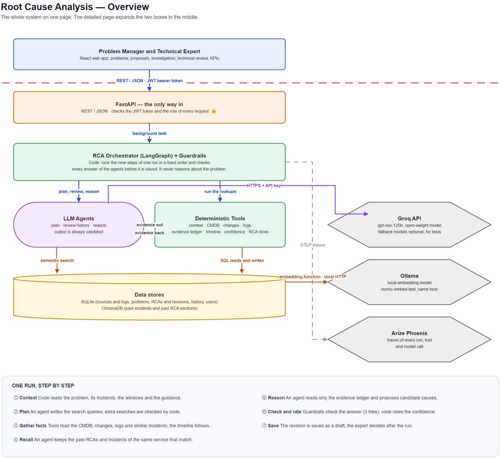
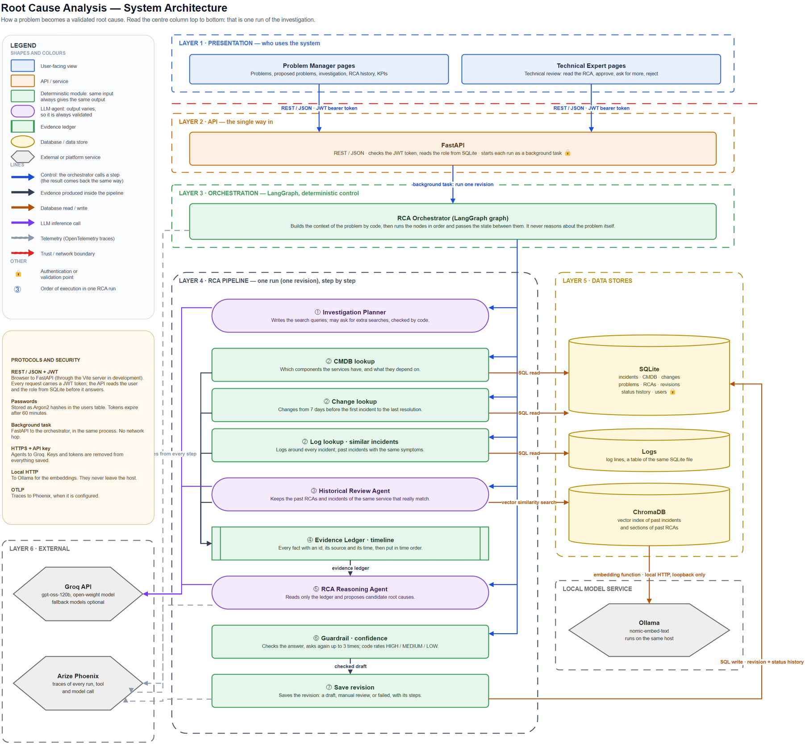
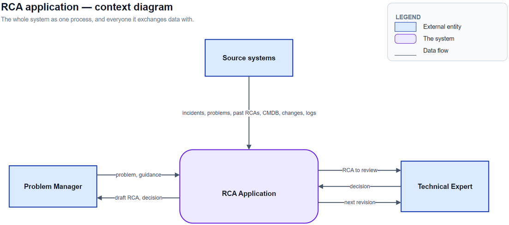
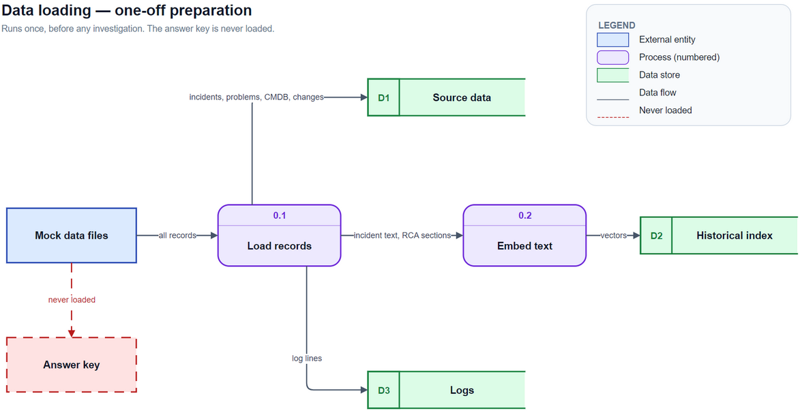
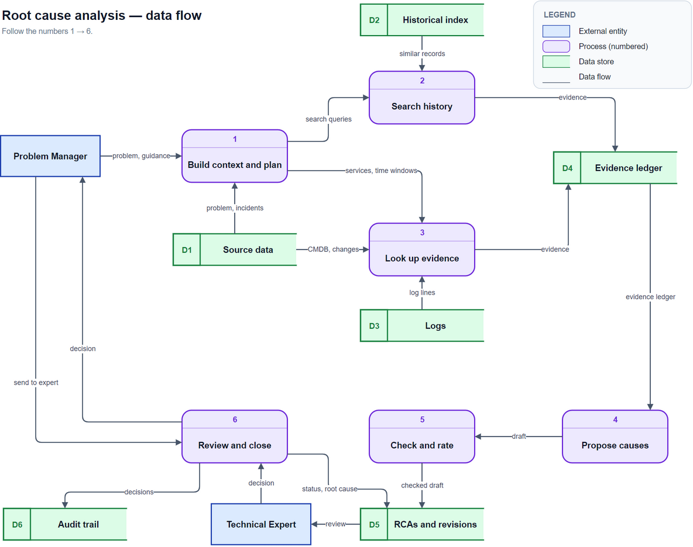
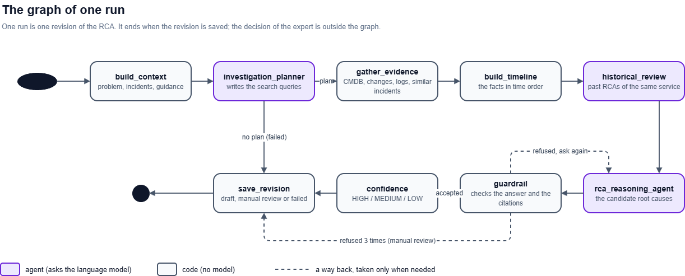
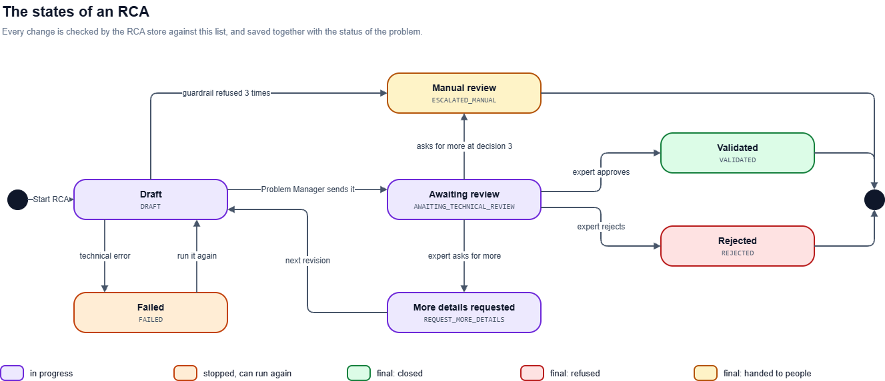

# 4. High-Level Architecture

**Project:** AI-assisted Root Cause Analysis (RCA) application
**Area:** Problem Management, large company
**Last updated:** 2026-10-22

---

## 4.1 Overview

The application is built in five layers. Each layer has one job and talks only to the
layer next to it.

| Layer | Job |
|---|---|
| Interface | What the two users see and click |
| API | Receives the requests, checks who sends them, and returns the answers |
| Orchestration | Runs the investigation step by step, and keeps the status of every problem and RCA |
| Reasoning and tools | Three LLM agents that think, and deterministic tools that fetch and check data |
| Data | The mock source systems, the vector database, the problems and the RCA records |

Two rules hold the design together:

- **Only the three LLM agents produce text.** Everything else is normal code with a
  predictable result.
- **Nothing becomes a validated root cause without a human approval.**

---

## 4.2 Architecture diagram

Two pictures of the same system. The first one is the whole system on one page. The
second one expands the orchestration and the pipeline in the middle of it.

*Figure 4.1 — The whole system on one page.*

*Figure 4.2 — The same system in detail: the orchestration and the pipeline expanded, step by step.*

Both diagrams have a legend. The grey dashed arrows are observability: every step reports
what it did to Phoenix, without changing the flow. The red dashed line is the boundary
between what the user reaches and what runs inside the application.

---

## 4.3 Components

### Interface

| Component | Responsibility | Technology |
|---|---|---|
| Problem Manager pages | Home, proposed problems, problems, investigation, RCA history, KPIs | React, TypeScript |
| Technical Expert pages | Home, technical review queue, the review page with the three decisions | React, TypeScript |

The web app lives in `web/`. It is built with Vite, React Router, TanStack Query, Tailwind
and Radix UI, in English and Romanian, and works from a 360 px wide screen. Pages are
loaded only when they are opened.

Each user signs in with a username and a password. The API answers with a token, and the
role in the token decides which pages the user sees. Users are created with
`scripts/create_user.py`; there is no sign-up page.

### Backend

| Component | Responsibility | Technology |
|---|---|---|
| API | Signs users in, checks the token and the role of every request, reads and changes problems and RCAs, starts investigations in the background, returns the KPIs | FastAPI |

The interface never talks to the database or to the model directly. Everything passes
through the API. The main routes, all under `/api/v1`:

| Route | What it does | Role |
|---|---|---|
| `POST /auth/login` | Signs in, returns a token valid for 60 minutes | Anyone |
| `GET /incidents`, `/incidents/unassigned`, `/incidents/{id}` | The incidents, the ones in no problem, one incident | Problem Manager (one incident: also the expert, for the RCAs sent to them) |
| `GET /services` | The services of the CMDB, for the guidance | Both |
| `GET /proposals`, `POST /proposals/accept`, `POST /proposals/reject` | The proposed problems, and the decision on one | Problem Manager |
| `GET /problems`, `GET /problems/{id}`, `POST /problems` | The problems, one problem with its history and RCAs, a problem created by hand | Problem Manager |
| `POST /problems/{id}/incidents`, `POST /problems/{id}/incidents/{incident}/remove` | Add or remove an incident | Problem Manager |
| `GET /problems/{id}/candidates` | The incidents that may be added, with their similarity | Problem Manager |
| `PUT /problems/{id}/guidance` | Save the guidance of the problem | Problem Manager |
| `POST /problems/{id}/close`, `POST /problems/{id}/reopen` | Close or reopen, with a reason | Problem Manager |
| `POST /problems/{id}/rcas` | Start RCA: creates the RCA and its first revision, the run goes on in the background | Problem Manager |
| `POST /rcas/{id}/revisions` | Start the next revision, or run a failed run again | Problem Manager |
| `POST /rcas/{id}/submit-review` | Send the draft to the Technical Expert | Problem Manager |
| `POST /rcas/{id}/review` | The decision of the expert: approve, reject, request more details | Technical Expert |
| `GET /rcas`, `/rcas/summaries`, `/rcas/{id}`, `/rcas/{id}/revisions`, `/rcas/{id}/history` | The RCAs, their revisions and their status history | Both (the expert sees only the RCAs sent to them) |
| `GET /rcas/{id}/diagram`, `/rcas/{id}/comparison` | The cause diagram, and what changed since the previous revision | Both |
| `GET /cases`, `/cases/{id}` | Every RCA as the list of its revisions | Both |
| `GET /kpis` | The four KPIs for a period | Problem Manager |

### Orchestration

| Component | Responsibility | Technology |
|---|---|---|
| RCA Orchestrator | Runs the nine steps of one investigation in order, and passes the state between them | LangGraph |
| RCA store | Keeps the RCAs, their revisions and their status; allows only the status changes listed in 4.5, each one in one transaction | SQLite and plain Python |
| Problem rules | Creating problems, adding and removing incidents, the rules for starting an RCA | SQLite and plain Python |
| Guardrails and validation | Checks the model output against the schema, checks the citations and the content rules, decides when to ask again | Pydantic and plain Python |

The orchestrator does not reason. It only routes.

### LLM agents

| Agent | What it does | Uses |
|---|---|---|
| Investigation Planner | Reads the problem and writes the search queries; may ask for extra searches, which code checks | Groq |
| Historical Review Agent | Judges the past RCAs and incidents the search found, and keeps only the ones that really match | Groq and ChromaDB |
| RCA Reasoning Agent | Correlates all the evidence and writes the candidate root causes | Groq |

### Deterministic tools

| Tool | What it does |
|---|---|
| Context builder | Reads the problem and its incidents, and sets the services and the time windows |
| CMDB lookup | Returns the components of a service and what they depend on |
| Change lookup | Returns the changes and deployments inside a time window |
| Log lookup | Returns the log lines of a service inside a time window, grouped by error type |
| Similar incidents search | Returns the past incidents that look like the most recent one |
| Evidence ledger | Stores every fact found, with an id, a type, a source and a timestamp |
| Timeline | Puts the evidence in time order and marks the first error |
| Confidence calculation | Turns the cited evidence into HIGH, MEDIUM or LOW |
| Cause diagram | Chooses 5 Whys or Fishbone from the shape of the result |
| Revision comparison | Says what changed between two revisions of the same RCA |
| Grouping proposals | Proposes which incidents belong together, from their embeddings |
| RCA record store | Saves and reads the RCAs, the revisions, the decisions and the history |

None of these calls a model. Each one can be tested with normal unit tests.

### External services

| Service | Role | Where it runs |
|---|---|---|
| Groq | The reasoning model, `openai/gpt-oss-120b`, open-weight, free tier | Cloud |
| Gemini, OpenRouter | Optional fallback models, for manual tests only, off by default | Cloud |
| Ollama | The embedding model `nomic-embed-text` for the vector search | Local machine |
| Arize Phoenix | Traces of every run, every tool and every model call | Local container |

---

## 4.4 Data workflow

This is how data moves through the system, from the mock files to the validated RCA.

The diagrams are kept simple on purpose: short names and only the symbols that are
needed. The explanation is in the text under them.

Three symbols are used. A rectangle is something outside the application. A rounded box
is a process the application performs. A box marked with a D number is a place where data
is kept.

*Figure 4.3 — The application and what is around it.*

*Figure 4.4 — Loading the data, done once.*

*Figure 4.5 — The investigation.*

Step by step:

1. **Preparation, done once.** `scripts/build_mock_data.py` writes the mock files.
   `scripts/load_sources_sqlite.py` loads the structured data into SQLite: incidents, CMDB,
   changes, logs and the starting problems. D1 and D3 are tables of the same SQLite file.
   `scripts/ingest_chroma.py` turns the text of the incidents and of the past RCA sections
   into vectors with the local embedding model, and stores them in ChromaDB (D2).
2. **Start.** The Problem Manager starts the RCA of a problem. The API creates the RCA and
   its first revision, puts the problem In investigation, and starts the run in the
   background.
3. **Build the context and plan.** Code reads the problem, its incidents, the guidance and,
   in a later revision, the request of the expert. The Investigation Planner writes the
   search queries.
4. **Collect.** The deterministic tools read the CMDB, the changes and the logs from
   SQLite, and search ChromaDB for similar past incidents. The historical search finds
   past RCAs and incidents of the same service.
5. **Store the evidence.** Every result becomes an evidence record with an identifier, a
   type, a source and a timestamp, and is placed on the timeline. Nothing goes further
   without being recorded here.
6. **Reason.** The RCA Reasoning Agent receives the evidence ledger and the timeline, and
   writes the candidate root causes, citing evidence identifiers.
7. **Check and rate.** The output is checked against the schema, the citations are checked
   against the ledger, and the confidence is calculated.
8. **Save.** The revision is saved as a draft (D5). The run ends here.
9. **Review and close.** The Problem Manager sends the draft to the expert. The decision of
   the expert changes the status of the RCA and of the problem, and is written to the
   history (D6).

The important part is step 5. Because every fact becomes a numbered evidence record before
the reasoning starts, the model can only build on things that really exist, and every
sentence in the RCA can be traced back to its source.

Two things are left out of the diagram on purpose. The ways back — a refused answer, a
failed run, a request for more details — belong to the states in 4.5, and drawing them
here would only make the data flow harder to read. Every process also writes to D6, not
only step 6, and those arrows are left out for the same reason.

---

## 4.5 Orchestration and states

### Why LangGraph

One investigation is a fixed sequence of steps, with two places where the flow can go
back: an answer the guardrail refuses is asked again, and a run without a plan ends early.
LangGraph gives us the state, the routing and these loops as normal graph nodes, streams
every step as soon as it ends, and opens the same graph in LangGraph Studio
(`langgraph.json`), which makes it easy to show and to trace in Phoenix.

The human decision is **not** a pause inside the graph. One run of the graph is one
revision of the RCA, and it ends when the draft is saved. The decision of the expert is
saved by the RCA store, and a request for more details starts a new run. So the waiting
time of a person, which can be hours, never keeps a run open.

The nine nodes, in order:

*Figure 4.6 — The graph of one run.*

### The state of an RCA

*Figure 4.7 — The states of an RCA.*

Every status change is checked by the RCA store against this list, and is saved in one
transaction together with the status of the problem: Start RCA puts the problem In
investigation, Validated closes it, Rejected opens it again (or sends it to manual review
at the second rejected RCA), and Manual review sends it to manual review.

Every finished step is saved on its revision as soon as it ends. If the application is
restarted while a run is in progress, the run cannot continue: at start-up it is saved as
Failed, with the reason, and the Problem Manager can run it again.

---

## 4.6 Handoffs

A handoff is the moment when one part gives work to another, and what it passes along.

| From | To | What is passed |
|---|---|---|
| API | Orchestrator | The id of the new revision, already saved |
| Context builder | Investigation Planner | The problem, its incidents, the guidance, the expert request, what earlier RCAs of the problem concluded |
| Investigation Planner | Orchestrator | The search queries and the extra searches, as validated JSON |
| Orchestrator | CMDB, change and log tools | The services and the time windows of the context, and the accepted extra searches |
| All tools | Evidence ledger | One evidence record per fact found |
| Orchestrator | Historical Review Agent | The past RCAs and incidents found, of the services of the problem only |
| Historical Review Agent | Evidence ledger | The records it kept, with what they share with the problem and how they differ |
| Evidence ledger | RCA Reasoning Agent | The complete list of evidence, the timeline, and a brief of what must be answered |
| RCA Reasoning Agent | Guardrails | The draft RCA, as JSON |
| Guardrails | Orchestrator | Accepted draft, or the problems found, which send the agent back to try again |
| Orchestrator | RCA record store | The finished revision |
| Interface | RCA record store (through the API) | The sending to the expert, and the decision of the expert with its comment |

Two handoffs deserve attention:

- **Evidence ledger to Reasoning Agent.** The reasoning agent receives the ledger and a
  brief built by code, nothing else. It cannot invent a source, because it never sees the
  raw systems.
- **Guardrails to Orchestrator.** If the JSON does not match the schema, or a citation
  points to an evidence id that does not exist, the draft is refused and the agent is
  asked again, with the problems included. After three refused attempts the RCA goes to
  manual review.

---

## 4.7 Observability and audit

Arize Phoenix, connected through OpenTelemetry, records the whole investigation when
`PHOENIX_COLLECTOR_ENDPOINT` is set. For every run we can open one trace and see:

- which steps ran, in which order, and how long each one took,
- what was sent to the model and what came back (the Groq calls are traced automatically),
- which tools were called, with which arguments and how many results,
- the guardrail result, the hypotheses and the calculated confidence.

The application keeps the same information in a permanent form, in SQLite:

- every **revision** keeps its steps, with a summary, the input of each step, the model
  that answered, the tokens and the time of every model request, and every tool run;
- the **status history** of every RCA keeps every change: who, when, the comment, and the
  full decision of the expert;
- the **history of every problem** keeps every change: incidents added and removed, the
  guidance, the status, the RCAs, with who did it and why.

Before anything is saved, secrets are removed: API keys, tokens and passwords are replaced
by a marker. So an RCA can be explained months later, after Phoenix has been restarted.

This is what makes the difference between a demo and an application that a company could
actually use: for every conclusion we can answer who decided it, on what basis, who
approved it and what was executed.

---

## 4.8 Delivery and deployment

The backend is delivered with Docker Compose, with two containers:

| Container | Content | Port |
|---|---|---|
| rca-fastapi-backend | FastAPI, the orchestrator, the agents, the tools, ChromaDB embedded | 8000 |
| rca-phoenix | Arize Phoenix | 6006 (and 4317 for OTLP) |

The `data/` folder is kept outside the container, so the SQLite database and the Phoenix
data survive a restart.

The web app runs from `web/` with `npm run dev` (port 5173), or as a built app with
`npm run build` and `npm run preview` (port 4173). In both cases the Vite server passes
the `/api` requests to the backend on port 8000, so the app and the API share one address.

The embedding model runs in Ollama on the host machine, at `localhost:11434`. The
reasoning model is called over the internet, on the Groq
free tier, with the key given as an environment variable. The token secret (`JWT_SECRET`)
is given the same way.
