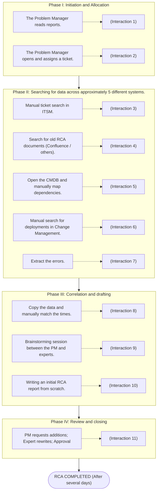
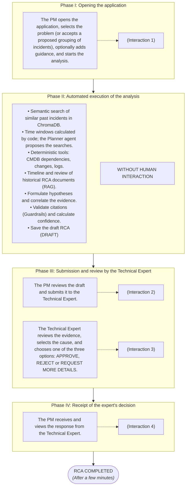

# KPI 1: Reducing human intervention

## Human interaction

## Multi-agent application-assisted process

## Calculation of process efficiency improvement percentage

### Approach I: Analysis of step weighting

| System metric | Manual | Automated (Agentic) |
| :--- | :---: | :---: |
| **Number of human steps** | 11 | 4 |
| **Percentage / step** | 9,09% / step | 25% / step |

* $4 \times 9{,}09\% = 36{,}36\%$ $\rightarrow$ If the number of assisted steps were compared to the percentage of a manual step.
* $100\% - 36{,}36\% = \mathbf{63{,}64\%}$ $\rightarrow$ **That is how much the process has been streamlined.**

---

### Approach II: Referencing the manual resolution base

* **$I_{\text{manual}} = 11$** (human interactions in manual RCA solving)
* **$I_{\text{agentic}} = 4$** (human interactions in the app-assisted RCA: start the analysis, submit the draft to the expert, the expert's decision, receipt of the decision)
* **Difference in steps:**
  $$I_{\text{manual}} - I_{\text{agentic}} = 11 - 4 = 7 \text{ saved interactions}$$

#### Efficiency calculation:

$$\text{Efficiency} = \frac{I_{\text{manual}} - I_{\text{agentic}}}{I_{\text{manual}}} = \frac{7}{11} \approx 0{,}636363\dots$$

In percentages:
$$0{,}636363\dots \times 100 \approx \mathbf{63{,}64\%}$$

> **RCA Process Efficiency Rate:** **`63,64%`** (reduction of human effort/interaction).

### Live measurement in the application

The KPIs page (`rca/kpis.py`, `GET /api/v1/kpis`) counts the real human steps of every RCA the expert decided, from its status history: 1 to start the RCA, 1 per sending to the expert, 1 per decision of the expert, 1 per further revision started, and 1 to read the final decision. The ideal path is the 4 steps above. Reduction = (11 − average) ÷ 11. The page also shows how many RCAs stayed on the ideal path and how many needed more steps.

# KPI 2: Self-resolution rate

It measures the software architecture's ability to complete an end-to-end technical workflow—from receiving the problem to fully delivering the analysis—100% autonomously, without human assistance or manual intervention to unblock the process during execution.

### 1. In the traditional process
* **Self-resolution rate = 0%** (no stage can be completed using only one's own resources).
* Ticketing systems, configuration management databases (CMDBs), logs, and deployment (change) processes operate in isolation without communicating with one another; consequently, no correlation is triggered when Root Cause Analysis (RCA) begins, as human interaction is required at each stage.

### 2. App-assisted process
* The Problem Manager selects a problem, starts the analysis and receives the completed draft at the end. The agentic workflow (planning, evidence collection, correlation, validation) runs without human help.

---

## Comparison by Execution Stages

| # | Stage| Manual | Automated (Agentic) |
| :-: | :--- | :--- | :--- |
| **1.** | **Case initiation** | The PM looks for tickets and groups the incidents manually. | The PM selects the problem and starts the analysis. |
| **2.** | **Identification of similar cases** | The person manually searches through old tickets. | The system searches past incidents semantically in ChromaDB. |
| **3.** | **Investigation planning** | The person manually selects the period and what to search. | Code calculates the time windows; the Planner agent proposes the searches. |
| **4.** | **Evidence collection – 4 sources** | The person opens each system (ITSM, CMDB, changes, logs) manually. | The System |
| **5.** | **Causal correlation & hypotheses** | The Person | The System |
| **6.** | **Evidence validation & structuring** | The Person | The System (guardrails and confidence score) |
| **7.** | **Submission to the Technical Expert** | The Person | The PM |
| **8.** | **Technical approval and closing** | The Person | The Technical Expert (approval closes the problem) |

---

## Comparative Calculation

### The Manual Case:
* $E_{\text{autonomy}} = 0$ *(a person intervenes in everything)*
* $N_{\text{steps}} = 8$
* $$\text{Auto-Resolution Rate}_{\text{Manual}} = \frac{0}{8} \times 100 = \mathbf{0\%}$$

### Application Use Case (Agentic)
* $E_{\text{autonomy}} = 5$ *(stages 2, 3, 4, 5, and 6 are executed without human intervention)*
* $N_{\text{steps}} = 8$
* $$\text{Auto-Resolution Rate} = \frac{5}{8} \times 100 = \mathbf{62{,}5\%}$$

> **Conclusion:** After automating the process, the self-resolution rate increases from **`0%`** to **`62,5%`**.
>
> **Limitation:** the 62,5% applies to the normal path. If the guardrail refuses the draft in all 3 attempts, the RCA becomes `ESCALATED_MANUAL`; after a technical error it becomes `FAILED` and the PM must run it again. In both cases a human must intervene.

### Live measurement in the application

Every run of an investigation (every revision) that ended is counted. It finished on its own when it produced an analysis. It needed a person when it stopped on a technical error (`FAILED`), or when the guardrail refused the draft in every attempt (`ESCALATED_MANUAL` without a decision of the expert). Rate = runs finished on their own ÷ all runs. The design value of 62,5% is shown next to it.

# KPI 3: AI Hypothesis Accuracy (Top-1 and Top-K Accuracy)

## 1. What does this KPI measure?
This metric assesses the multi-agent system's ability to identify the true root cause of an incident and rank it prominently in the candidate list submitted to the Technical Expert.

For the human expert reviewing the report, the practical utility of the AI assistant comes down to one decisive question: **"Is the correct root cause present in the proposed hypothesis list?"**:
- If **YES**, the expert reviews the cited evidence and validates the finding with a single click.
- If **NO**, the automated analysis was unhelpful, the expert's time was wasted, and a manual investigation must be started from scratch.

---

## 2. Calculation Formulas

By design, the system produces at least 2 candidate hypotheses per incident to explore alternative scenarios and mitigate premature closure bias. Because an incident typically has a single primary root cause (Ground Truth), performance cannot be evaluated using a naive metric like "correct hypotheses divided by total hypotheses generated" (which would be artificially capped at ~33–50%).

Instead, two standard ranking and retrieval metrics are evaluated across the total number of investigated incidents:

$$\text{Top-1 Accuracy} = \frac{\text{Number of incidents where Hypothesis \#1 is correct}}{\text{Total investigated incidents}} \times 100$$

- **Top-1 Accuracy:** Quantifies how frequently the highest-ranked candidate (the one with the highest confidence level / points) corresponds directly to the true root cause.

$$\text{Top-K Accuracy} = \frac{\text{Number of incidents where the true cause is in the candidate list}}{\text{Total investigated incidents}} \times 100$$

- **Top-K Accuracy:** Quantifies the overall success rate of the pipeline, verifying whether the correct explanation appears anywhere in the generated list (Hypothesis 1, 2, or 3).

*Representative Example:* Across a suite of 13 investigated incidents, if the top hypothesis is correct in 9 cases, and the true cause appears somewhere in the proposed list in 12 cases, the results are:
- **Top-1 Accuracy = 69.2%**
- **Top-K Accuracy = 92.3%**

---

## 3. Technical Decision Rule (Correctness Criterion)

Because the reference cause (`true_root_cause`) in the evaluation dataset is expressed in free-form natural language, validation cannot rely on exact string matching.

A candidate hypothesis is declared **CORRECT** if and only if it satisfies both technical equivalence criteria:
1. **Same Technical Component:** Identifies the exact service, resource, or configuration at fault (e.g., PostgreSQL/HikariCP pool, CoreDNS replica count, cert-manager secret token).
2. **Same Failure Mechanism:** Accurately describes how the failure occurred (e.g., connection starvation triggered by autoscaling, unclosed SQL session in error retry block, DNS challenge token expiration).

If the hypothesis blames an innocent component, a secondary factor (red herring), or an unrelated failure mechanism, it is marked as **INCORRECT**.

---

## 4. Measurement Methodology and Execution

Measurements are collected autonomously using the dedicated evaluation script (`scripts/eval_kpi_accuracy.py`):

1. **Data Loading:** The script loads the incidents from `data/sources/incidents.json` and matches each case against the benchmark stored in `data/evaluation/answer_key.json`.
2. **Pipeline Execution:** For each incident, `run_investigation(incident_id)` executes the entire multi-agent workflow (Planner $\rightarrow$ Tools $\rightarrow$ Reasoning $\rightarrow$ Guardrails $\rightarrow$ Confidence).
3. **Semantic Arbitration:**
   - **Automated Mode (`--judge auto`):** An LLM serving as an impartial technical arbitrator (LLM-Judge from `rca/judge.py`, model `JUDGE_MODEL`, Gemini by default, distinct from the agents' model) compares the hypothesis text against `true_root_cause` using a structured schema, returning a binary verdict (`is_match = true/false`) alongside a concise rationale.
   - **Manual Mode (`--judge manual`):** The script presents the reference cause and the AI-generated candidates in the terminal, prompting a human operator to enter the verdict (`y`/`n`).
4. **Metric Aggregation & Reporting:**
   - The script tracks Top-1 and Top-K matches per case.
   - Runs that fail technically (exception or status `FAILED`) and incidents where the judge returned no verdict are excluded from the denominator and listed in the report (`run_errors`, `judge_errors`). A run ending `ESCALATED_MANUAL` (no hypotheses) counts as a miss.
   - The JSON report (`data/evaluation/kpi_accuracy_report.json`) is rewritten after every incident and holds the aggregated scores, the RCA status and the detailed verdict for every hypothesis, providing a full audit trail.
   - Investigations run on a temporary copy of the database, so the application data is untouched.

## 5. Live measurement in the application

In the application the Technical Expert is the judge. Of the RCAs the expert decided for good (`VALIDATED`, `REJECTED`, or `ESCALATED_MANUAL` after the last request):

- **Top-K** = validated ÷ decided;
- **Top-1** = validated with the hypothesis that was first in the approved revision ÷ decided.

The KPIs page shows the live values next to the benchmark of this script, when its report was written by the current version of the script.

# KPI 4: Confidence Calibration & Correctness

## 1. What does this KPI measure?
This metric assesses whether the system's assigned confidence level (`HIGH`, `MEDIUM`, or `LOW`) for the primary candidate hypothesis accurately reflects the strength of the underlying evidence, matching the benchmark expectations (`expected_outcome.acceptable_confidence`) in `answer_key.json`.

In an enterprise Human-in-the-Loop architecture, an overconfident AI is just as damaging as an inaccurate one. Out of the 13 benchmark scenarios, **6 represent edge cases (`kind: "edge"`)** — characterized by missing logs, uninstrumented third parties, absent historical precedents, or conflicting signals. Under SRE and ITIL standards, the correct diagnostic behavior for these cases is acknowledging uncertainty, which the benchmark expresses per scenario through `acceptable_confidence` (e.g. `["LOW"]` or `["MEDIUM", "LOW"]`). Where the benchmark also defines `expected_outcome.weakly_supported`, the script reports separately how often the application's `weakly_supported` flag agrees with it (supplementary metric, not part of the formula below).

## 2. Calculation Formula

$$\text{Confidence Calibration Rate} = \frac{\text{Scenarios where } \text{confidence}(\text{Hypothesis } 1) \in \text{acceptable\_confidence}}{\text{Total investigated scenarios}} \times 100$$

- **Numerator:** Scenarios where the top-ranked hypothesis receives a confidence rating explicitly allowed by the benchmark specification (e.g., `["HIGH"]`, `["MEDIUM", "LOW"]`, or strictly `["LOW"]`).
- **Denominator:** Scenarios whose investigation completed ($N \le 13$). Technical failures (exception or `FAILED`) are excluded and listed in the report; an `ESCALATED_MANUAL` run has no hypothesis and counts as not calibrated.
- **Script:** `scripts/eval_kpi_confidence.py` (report: `data/evaluation/kpi_confidence_report.json`, written after every scenario).

## 3. Business & Operational Relevance
- **Mitigates Automation Bias:** Prevents the human expert from rubber-stamping weakly supported findings.
- **Drives Observability Remediation:** A `LOW` confidence rating tells engineering teams that diagnostic telemetry is missing rather than offering false closure.
- **Validates Deterministic Scoring:** Proves that the rule-based scoring engine in `rca/confidence.py` penalizes missing evidence correctly, irrespective of LLM prose generation.

## 4. Live measurement in the application

Every decision of the expert is grouped by the confidence of the first hypothesis of the revision it was taken on (HIGH, MEDIUM, LOW), and the share approved is computed for each level. The confidence is well calibrated when HIGH is approved more often than MEDIUM, and MEDIUM more often than LOW. The KPIs page shows it next to the benchmark of `scripts/eval_kpi_confidence.py`.
